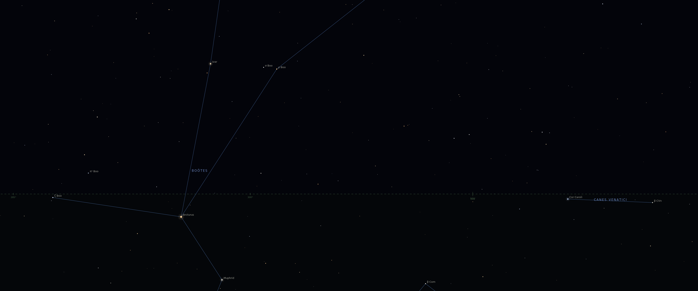

# Skywall

**Your desktop wallpaper is the sky behind your monitor, right now.**

Skywall draws a star chart of exactly the patch of sky your screen is facing — as if the monitor were a window and the Earth were see-through — and refreshes it every minute. Stars, planets, the Moon (with its phase), constellation lines, star names. When something catches your eye, right-click the desktop (or press <kbd>Super</kbd>+<kbd>Alt</kbd>+<kbd>S</kbd>) and [Stellarium](https://stellarium.org) opens aimed at the very same view.



Think [Sky Map](https://github.com/sky-map-team/stardroid), but for a desktop that doesn't move.

## What it does

- **Real positions, nothing decorative.** ~15,000 catalogued stars (to magnitude 7) at their computed positions, coloured by their real colour index; Sun, Moon and the eight planets from the JPL ephemeris.
- **A true window.** Perspective projection with a vertical image plane: the horizon is a straight line at your eye level and vertical lines stay vertical. A stereographic mode is there for very wide fields of view.
- **Always night, Earth see-through.** Stars are shown at noon and below the horizon too; the horizon is marked with a dashed line and compass ticks.
- **Labels like a planetarium.** Constellation lines and names, proper star names (Arcturus, Izar…), Greek-letter designations for unnamed bright stars (ζ Boo, κ² Boo…), planet labels — each toggleable.
- **Practically free to run.** A systemd user timer renders one PNG per minute (~0.3–0.4 s of CPU) and exits. Nothing runs in between, nothing animates.
- **Polite.** Turning it off restores the wallpaper you had before. Your location never leaves the machine.

## Requirements

- Linux with **GNOME** (tested on GNOME 43 / X11, Debian 12), or **Windows 10/11** — see [Windows](#windows).
- System **Python ≥ 3.11 with PyGObject, pycairo, GTK 4 and libadwaita ≥ 1.2** — on Debian/Ubuntu: `sudo apt install python3-gi python3-gi-cairo gir1.2-gtk-4.0 gir1.2-adw-1`.
- **Stellarium** as a Flatpak (`flatpak install flathub org.stellarium.Stellarium`). Skywall reads its constellation lines once on first run, and uses it for the interactive view.
- Internet on first run only, to download the star catalogue (~35 MB) and planetary ephemeris (~17 MB).

## Install

```bash
git clone https://github.com/lardahle/skywall.git ~/skywall
cd ~/skywall && ./install.sh
```

This creates a virtualenv, installs the systemd user timer, adds **Skywall** to the app grid, binds <kbd>Super</kbd>+<kbd>Alt</kbd>+<kbd>S</kbd>, and installs the right-click menu extension. On X11, restart GNOME Shell once (<kbd>Alt</kbd>+<kbd>F2</kbd>, `r`, <kbd>Enter</kbd>) or log out and in so the extension loads.

Then open **Skywall** from the app grid:

1. **Location** — type your latitude/longitude (or import Stellarium's).
2. **Monitor direction** — hold a phone flat against the back of the monitor and read its compass. Pick *Magnetic* or *True north* to match your compass app; magnetic readings are corrected with the World Magnetic Model.
3. **System → Live sky as wallpaper** — on. Optionally *Start with GNOME session*.

### Making it a true window

For the literal view through your monitor, set the field of view and tilt from your seating position (*Sky* tab):

- **FOV** = 2 · atan(½ · screen width ÷ eye distance). Example: an 80 cm-wide screen seen from 96.5 cm → 2 · atan(40 / 96.5) ≈ **45°**.
- **Tilt** = atan(height of the screen centre above your eye line ÷ eye distance). Example: eyes on the lower-third line of a 33.4 cm-tall screen → atan(5.57 / 96.5) ≈ **3.3°**, which puts the horizon on your eye line.

## Windows

Works on Windows 10/11 with Python ≥ 3.11 from python.org. Stellarium is optional (`winget install Stellarium.Stellarium`): without it, constellation lines are downloaded once from Stellarium's GitHub.

```powershell
git clone https://github.com/lardahle/skywall.git; cd skywall; .\install.ps1
.\.venv\Scripts\skywall settings   # opens config.toml in Notepad: set latitude, longitude, facing_deg, width/height
.\.venv\Scripts\skywall enable
```

What's different from GNOME:

- **Refresh** — a hidden Task Scheduler task (`Skywall`) runs `pythonw -m skywall.cli render` every minute, also on battery. It keeps running across sign-outs and reboots until `skywall disable`, so `autostart` does nothing here.
- **Settings** — there's no GTK window on Windows; `skywall settings` opens the TOML file in Notepad.
- **Stellarium hand-off** — Start menu → *Skywall - Open in Stellarium*, hotkey <kbd>Ctrl</kbd>+<kbd>Alt</kbd>+<kbd>S</kbd>, or right-click the desktop → *Show more options* → *Open sky in Stellarium*.
- **Size** — set `width`/`height` to the panel's physical pixels (e.g. 3840×2160 for a 4K panel at 150% scaling).
- **Paths** — config in `%APPDATA%\skywall\config.toml`, data and images in `%LOCALAPPDATA%\skywall\`.
- Turning it off restores your previous picture. If that was Windows Spotlight, you'll get the last Spotlight image back as a static picture. Switch Spotlight back on in Settings → Personalization → Background.

## Command line

```
skywall render [--output FILE]   render now (sets the wallpaper only while live is on)
skywall enable | disable         turn the live wallpaper on / off (off restores your old one)
skywall autostart on|off         start with the GNOME session
skywall open                     open Stellarium aimed at the same view
skywall settings                 settings window
skywall install                  (re)install timer, app entry, shortcut and extension
```

Config lives in `~/.config/skywall/config.toml`; data and rendered images in `~/.local/share/skywall/`.

## Known limits

- The right-click extension targets **GNOME Shell 43–44** (legacy `imports`). GNOME 45+ needs a port to ES modules — contributions welcome.
- Constellation lines currently require a local Stellarium install (read once, then cached).
- One monitor; deep-sky objects and the Milky Way aren't drawn yet.
- If you have enabled *south-based azimuth* in Stellarium, the "open in Stellarium" view will point the wrong way.

## Development

```bash
.venv/bin/python -m pytest -q            # full suite (first run downloads test data to ~/.cache/skywall-test-data)
.venv/bin/python -m pytest -q -m "not network"
```

Design notes from the first build are in [`docs/design/`](docs/design).

## Sources and credits

Data and models Skywall computes from:

- **Star catalogue** — [HYG Database v4.1](https://github.com/astronexus/HYG-Database) by David Nash / astronexus, licensed [CC BY-SA 4.0](https://creativecommons.org/licenses/by-sa/4.0/). Downloaded at first run (not redistributed here); positions, proper motions, magnitudes, colour indices, proper names and Bayer designations. HYG is in turn compiled from the ESA **Hipparcos** catalogue (Perryman et al. 1997, ESA SP-1200), the Yale Bright Star Catalog and the Gliese Catalog of Nearby Stars.
- **Constellation lines and names** — the *Modern* sky culture from [Stellarium](https://github.com/Stellarium/stellarium) (GPL-2.0-or-later), read from your local Stellarium installation; figures follow the IAU constellations.
- **Sun, Moon and planet positions** — NASA/JPL planetary ephemeris **DE421** (Folkner et al. 2008, JPL IOM 343R-08-003), via [Skyfield](https://rhodesmill.org/skyfield/).
- **Magnetic declination** — the **World Magnetic Model 2025** (NOAA NCEI and the British Geological Survey), via [pygeomag](https://github.com/boxpet/pygeomag).

Software it builds on:

- [Skyfield](https://rhodesmill.org/skyfield/) by Brandon Rhodes (MIT) — astrometry, apparent positions, Moon phase.
- [NumPy](https://numpy.org) (BSD-3-Clause), [pycairo](https://pycairo.readthedocs.io) / [Cairo](https://cairographics.org) (LGPL-2.1 / MPL-1.1), [PyGObject](https://pygobject.gnome.org), GTK 4 and [libadwaita](https://gnome.pages.gitlab.gnome.org/libadwaita/) (LGPL-2.1+), [pygeomag](https://github.com/boxpet/pygeomag) (MIT), [tomli-w](https://github.com/hukkin/tomli-w) (MIT).
- [Stellarium](https://stellarium.org) (GPL-2.0-or-later) — the interactive view, driven through its [scripting API](https://stellarium.org/doc/head/scripting.html).

Inspiration and prior art: [Sky Map](https://github.com/sky-map-team/stardroid) (the "hold your phone up to the sky" idea), [Stellarium](https://stellarium.org), and [Caelum](https://github.com/Juliowilly/caelum), a photoreal live-sky desktop widget for GNOME.

## License

Skywall's code is [MIT](LICENSE). Data it downloads or reads keeps its own license (see above) — notably the HYG catalogue is CC BY-SA 4.0 and Stellarium's sky-culture data is GPL-2.0-or-later.
